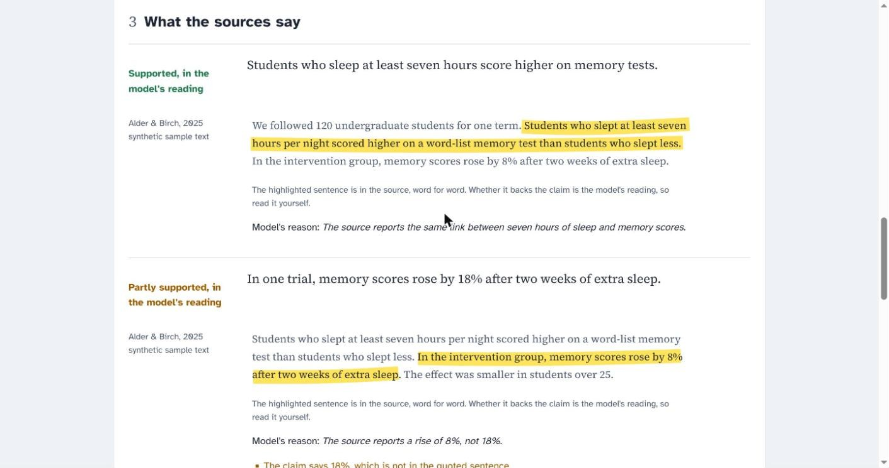

# Show Me Where

Paste a paragraph that cites sources, and Show Me Where checks each cited claim against the cited source, showing the exact source sentence behind every grade.
If the model's quote is not a whole sentence found word for word in the source, the app throws the grade away and says "cannot tell".

Built for SLAY HACKS 2026.
The full design is in [SPEC.md](SPEC.md), and the submission text is in [submission/DEVPOST.md](submission/DEVPOST.md).



## Status

- The sample run works end to end with no key, and is labelled on screen as a synthetic, hand-written example.
- Live mode is built: citation parsing, source fetching from Europe PMC and OpenAlex, the OpenRouter call, and every check.
- The live model call has been tested only against a recorded HTTP 401 reply and a hand-written reply in the documented response shape. It has not yet run with a real key. Until it has, nothing in this repository claims a real model result.
- Not yet deployed. `.github/workflows/pages.yml` deploys the static build to GitHub Pages under `/show-me-where/` on every push to `main`, after lint, type-check, tests and build pass.

## Run it

You need Node 26 and pnpm 10.

```sh
pnpm install
pnpm dev        # local dev server
pnpm test       # unit and component tests
pnpm lint
pnpm typecheck
pnpm build      # static files in dist/
```

For a live run you need an OpenRouter key.
Only free models, whose ids end in `:free`, are accepted.

## How it works

1. The text is split into body and reference list at a `References`, `Bibliography` or `Works Cited` heading.
2. The citation style is read from the list: numbered (`[1]`, `[2, 3]`, `[2-4]`) or APA author-year (`(Smith & Jones, 2020)`, `(Lee et al., 2019a, p. 4; Smith, 2020)`, `Smith (2020) found`).
3. Each sentence with a citation becomes a claim. Sentences without one are listed as not checked. Citations that match nothing in the list are named (bracketed numbers above 999 are read as years, not references).
4. When a sentence cites different sources in independent clauses ("A rose [1], while B fell [2]"), each source is checked against its own clause.
   A shared opening such as "No evidence shows that", a later part without its own clause opener and subject, narrative citations, one citation group, parts under three words, or words after the final citation make every source use the whole sentence.
   A later part shows its own subject only through a word such as "the", "it" or a number at its start, or one or two words followed by a verb such as "was" or "did"; continuations such as "but reduces mortality" or "while significantly reducing mortality" keep the whole sentence so the shared subject stays visible.
   A source cited more than once uses the whole sentence; other sources can keep their scopes.
5. For each cited reference with a DOI, the app reads open-access full text from Europe PMC, or else the abstract from OpenAlex. Other sources are pasted by the user.
   Scientific superscripts and subscripts stay explicit, such as `10^(6)` and `H_(2)O`.
   Full text is limited to 120,000 characters at a paragraph boundary, or a complete sentence boundary if the first paragraph is too long.
   If no complete sentence fits, the app tries the abstract.
6. Each claim and one source's text go to a free OpenRouter model. The model must answer with a grade, one whole sentence copied from the source, and a reason.
7. The app keeps a grade only if the quote is one or more whole sentences found in the source text and shares at least one key word with the claim when the claim has extractable key words. It normalises only quotes, dashes, ligatures, invisible characters and whitespace.
8. A kept quote is shown highlighted between the sentences before and after it, with warnings when the claim has a number the quote lacks, or the quote has a negation, a hedge, or earlier-work wording that the claim lacks.
9. A claim shows a backing grade only if every cited source backs it. If one source backs a cited scope and another contradicts that same scope, it reads "Sources disagree".
   Opposing grades on different scopes, or a source that could not be read or checked, give "Not every cited source backs it".

## What it does not do

- It does not decide whether a quote really backs a claim. That is the model's reading, and the page says so beside every quote.
- It does not read paywalled papers, PDFs, or web pages. Paste their text instead.
- It does not support citation styles other than numbered and APA author-year.
- It does not judge whether a source is trustworthy.
- Its prompt-injection defences (a per-call random fence around the student's text and the source, the rules repeated after them, links stripped from model text, and quotes that share no key word with a claim that has extractable key words discarded) lower the risk from hostile text but do not remove it. A hostile source could still steer the model to a real sentence that shares a word with the claim.
- Sentence boundaries come from a rule-based splitter. It knows common abbreviations, dotted initials such as "J.A." and "U.S.", and ellipses, but an abbreviation it does not know can still end a sentence early, which could let a quote start mid-sentence.
- A reference line that does not look like the start of an entry is joined to the entry above it. Step 2 shows every source's full text, so check it there.
- A DOI containing `<` or `>` (old Wiley SICI DOIs) is cut short and will not be found; paste that source's text instead.

## Outside services it calls

In the sample run, none.
In a live run, and only then:

| Service | What is sent | Why |
|---|---|---|
| Europe PMC REST API (`www.ebi.ac.uk/europepmc/webservices/rest`) | The DOI | Find and read open-access full text |
| OpenAlex (`api.openalex.org`) | The DOI | Read the abstract when there is no open-access full text |
| OpenRouter (`openrouter.ai/api/v1/chat/completions`) | Each claim and its source text, with your key | Ask a free model for its reading |

Your key is kept only in the page's memory. It is never written to browser storage, because storage is shared by every page on the same github.io address, and it is forgotten when you switch to the sample run or close the page.
There is no server, proxy, or analytics of ours.
Fonts are bundled with the app, so no font service is called.

## Third-party code and licences

| What | Source | Licence | How it is used |
|---|---|---|---|
| Highlighter component | Magic UI, `apps/www/registry/magicui/highlighter.tsx` | MIT | Adapted in `src/ui/Highlighter.tsx` with the notice kept; draws the highlighter stroke behind the verified quote |
| rough-notation 0.5.1 | npm | MIT | Draws the stroke for the highlighter |
| Atkinson Hyperlegible | `@fontsource/atkinson-hyperlegible` | SIL OFL 1.1 | Interface typeface, bundled |
| Source Serif 4 | `@fontsource/source-serif-4` | SIL OFL 1.1 | Typeface for student text and source passages, bundled |
| React, React DOM, scheduler | npm | MIT | Bundled into the site; the build drops their licence headers, so the notices file carries them |
| Vite, Vitest, ESLint, TypeScript | npm | MIT or Apache-2.0 | Build and test tooling, not shipped |

The full licence texts for these, including the SIL Open Font License for the bundled fonts, are in [public/THIRD_PARTY_NOTICES.txt](public/THIRD_PARTY_NOTICES.txt), which ships with the site and is linked from its footer.
Show Me Where itself is released under the [MIT License](LICENSE).

Considered and not used:

- React Bits: its licence is "MIT + Commons Clause" and forbids redistributing the components themselves, and this repository is public.
- Kesh's Forge organisation: a search for matching components returned none that fit.
- 21st.dev: not used; the one component this design needed came from Magic UI.

## Screenshots

All screenshots are from a local build in Chrome, at 1440 or 390 CSS pixels wide, and are in [docs/screenshots](docs/screenshots).
The sample screens show the synthetic example.
The live-mode error screens used a placeholder key that is not a real key.

## How it was built

The project was built by AI coding agents directed by Kesh and reviewed by independent automated reviewers.
